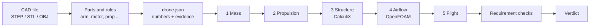

# OpenCAE Studio

OpenCAE Studio is a desktop program for engineering drones. You give it a CAD file and a sheet of numbers
(motor, propeller, battery, materials), and it works out the mass, thrust, hover time, strength of the arms or
wing, airflow around the whole aircraft and a simulated hover, then checks the result against requirements.
The same engine runs from the app, from a command line and from a typed-command console inside the app. Every
number comes from a real calculation or solver run. A missing input is reported as missing; it is never guessed.

**Simulation results plan your tests. They are not flight approval.**

## At a glance

| Mode | Use it to | Start it |
|---|---|---|
| **Drone** | Analyse any drone from a CAD file (STEP, STL, OBJ) and a parameter sheet. Run, read results, try design changes. | Ribbon tab `Drone`, or `opencae-studio --drone <folder>` |
| **Studio** | General CAD, meshing and finite-element work: parts, meshes, loads, results, reports. | The other ribbon tabs (Home, Geometry, Mesh ...) |
| **K09-L** | The K09-L tailsitter design study: detailed analyses and a design-review website. | `Drone` tab, button `K09-L`, or `open_website.bat` |

Contents: [Install and start](#2-install-and-start-on-windows) |
[Quick start](#3-quick-start-your-first-drone-in-5-minutes) | [How it works](#4-how-it-works-the-pipeline) |
[Interface tour](#5-the-interface-tour) | [drone.json](#6-the-dronejson-parameter-file) |
[Command line](#7-command-line-for-agents-and-scripts) | [K09-L](#8-k09-l) |
[Troubleshooting](#9-troubleshooting) | [Developers](#10-for-developers) | [Rules](#11-engineering-rules-and-licence)

---

## 1. What OpenCAE Studio is

* **Drone mode** turns a CAD file plus a parameter sheet (`drone.json`) into five analyses and a verdict. Results
  are shown on a dashboard with a 3D model, contour plots, a flight replay and a design-iteration tab.
* **Studio mode** is the general application the drone mode sits on: OpenCascade CAD, Gmsh meshing, CalculiX
  structural / thermal / modal / buckling solves, OpenFOAM flow, results, plots and reports.
* **K09-L** is a detailed engineering study of one tailsitter, kept as an example and a design-review website.

| Layer | Library | Role |
|---|---|---|
| UI | PySide6 (Qt) | main window, ribbon, docks |
| 3-D view | VTK, PyVista, pyvistaqt; three.js in the dashboard | rendering, picking, contours |
| CAD kernel | OpenCascade via OCP (`cadquery-ocp`) | solids, booleans, STEP / IGES import |
| Mesher | Gmsh Python API | tetrahedral volume meshes |
| Solvers (external programs) | CalculiX `ccx`; OpenFOAM (airflow, drone and Studio) | structure and heat; airflow |
| Data | NumPy, SciPy, meshio, Matplotlib | arrays, export, plots |

---

## 2. Install and start on Windows

Requirements: Windows, a conda (Miniforge) environment with Python 3.11 or newer and the libraries
(PySide6, VTK, OCP, Gmsh, pyvistaqt, and MuJoCo for Motion mode). The default environment name is `qt_test`. The launcher installs nothing and
changes no system setting.

Open PowerShell and run:

```powershell
cd E:\Calculix\OpenCAE-Studio-0.1.0
conda activate qt_test
.\launch_opencae.bat
```

`launch_opencae.bat` finds conda, activates `qt_test` for that window only, checks the libraries and starts the app.

| Launcher option | What it does |
|---|---|
| `launch_opencae.bat project.ocae` | Start and open a Studio project |
| `launch_opencae.bat --doctor` | Check Python, libraries and CalculiX, then wait |
| `launch_opencae.bat --acceptance` | Run the GUI acceptance test (a cantilever through the whole Studio workflow) |
| `OPENCAE_GUI_ENV`, `OPENCAE_CONDA_ROOT` | Environment variables that choose another conda environment or conda folder |

Extra start-up options (pass them after the launcher, or to `opencae-studio` / `python -m opencae.app.main`):

| Option | What it does |
|---|---|
| `--drone DIR` | Open Drone mode on a drone project folder |
| `--example cantilever` or `tiltwing` or `k09l` or `k09l-revB` or `k09l-monitor` | Open a built-in example |
| `--safe` | Safe mode: the dashboard opens in your browser and graphics use software rendering |
| `--diagnose` | Print a JSON report (Python, PySide6, VTK, OS, QtWebEngine, CalculiX and OpenFOAM paths, log files, last crash) and exit |
| `--selftest DIR` | Run the cantilever workflow in the GUI, write `DIR/selftest.json` and exit |

For Linux or macOS: `pip install -e ".[motion]"` (the `motion` extra adds MuJoCo), then `opencae-studio` (install
CalculiX from your package manager).

**MuJoCo (Motion mode).** `pip install -r requirements.txt` and the `INSTALL_WINDOWS.md` pip line both include it
(`mujoco`, pinned in `requirements.txt`). It is optional: the app starts without it, and Motion studies then say that
MuJoCo is missing and how to install it. To add it later, either run
`python -m pip install mujoco` in the same Python environment, or click the **MuJoCo (motion)** button in the
Solvers dialog (the `Solvers…` button of the Drone tab), or run `opencae setup mujoco --yes` (nothing is installed without the click or `--yes`; the size is
shown first and `import mujoco` is checked afterwards). `python -m opencae doctor` shows the version, or
`not installed — Motion studies unavailable; install with: python -m pip install mujoco`.

### Which solver is needed for what

| Program | Needed for | How the app finds it |
|---|---|---|
| **CalculiX** (`ccx`) | Drone `structure` analysis; all Studio structural, thermal and modal solves | Path set in `Tools > Settings`, then the environment variable `OPENCAE_CCX`, then your `PATH`, then every conda environment (for example one named `opencae`), then standard install folders. It runs in its own process with its own DLL search path, so its libraries never mix with Qt's. |
| **OpenFOAM** (ESI v2006 or newer) | Drone `cfd` analysis (whole-aircraft airflow) and all Studio flow studies | Linux or WSL install found automatically. On Windows it runs inside WSL through `wsl.exe`; the `Solvers...` button (or `opencae setup openfoam --yes`) installs it there (see [docs/WINDOWS_SETUP.md](docs/WINDOWS_SETUP.md)). The `Tools > Settings` page can point to an existing one, and `OPENCAE_OPENFOAM` also works. |
| **MuJoCo** (Python package `mujoco`) | Motion mode: multibody studies of assemblies (gripper, rotors) | Imported from the Python environment that runs OpenCAE; `python -m opencae doctor` reports it |

Without CalculiX the app still runs: `mass`, `propulsion` and `flight` work, and `structure` reports an error that
names `ccx`. Without OpenFOAM `cfd` reports an error that names OpenFOAM. Check what was found with:

```powershell
python -m opencae doctor
python -m opencae.app.main --diagnose
```

---

## 3. Quick start: your first drone in 5 minutes

1. Start the app (section 2). Click the ribbon tab **Drone**.
2. Click the **Quad 250** card (or the ribbon button `Quad 250`). A 5-inch quadcopter with typical numbers opens.
   The example is copied to `%USERPROFILE%\.opencae\projects\quad250`.
3. Look at the 3D model on the right and the parameter sheet on the left. Each number shows where it came from
   (estimate, datasheet, measured, user).
4. Press **Run all** (F5). The progress bar shows each analysis. Mass and propulsion take seconds, structure a
   few minutes, flight under a minute. Airflow is the slow one (5 to 20 minutes on the coarse setting).
5. Read the **Results** tab: one card per analysis with a status colour and a plain sentence, and the overall
   verdict at the top. Because the example uses typical numbers, expect **conditional**, not a pass.
6. Click **Contours** to colour the 3D model by stress or pressure, and **Flight** to replay the hover.

### Your own drone

Click **New drone** (Ctrl+N). A three-step wizard opens:

| Step | What you do |
|---|---|
| 1. Your CAD file | Pick the STEP, STL or OBJ file, a project folder, a name and the type (multirotor, fixed wing, tailsitter, VTOL). |
| 2. Check the parts | Each part got a role (arm, motor, prop, battery, wing ...) from its name. Change any role that is wrong. |
| 3. Key numbers | Motor KV, prop diameter and pitch, battery cells and capacity, frame material. Tick "I don't know yet" to leave a value empty. |

Numbers typed in the wizard are saved as **estimates**. Open the parameter sheet, fill in the rest, and raise a
value to `datasheet` or `measured` when you have the source. Press **Save** (Ctrl+S), then **Run all** (F5).

Tip: a 0.25 m quad saved in metres needs `geometry.units` set to `m`, otherwise it is read as 0.25 mm.

---

## 4. How it works: the pipeline



In text: CAD file, parts and roles, parameter sheet, mass, propulsion, structure, airflow, flight, checks, verdict.

### What each analysis does

| Analysis | In plain words | Typical time | Needs |
|---|---|---|---|
| **Mass** (`mass`) | Adds the part masses (a mass you typed, the motor mass, or density times the volume of a closed CAD solid), then finds the centre of gravity and inertia. | seconds | A mass or a material density for every part |
| **Propulsion** (`propulsion`) | Finds where each motor and propeller settle. Reports thrust at full throttle, thrust-to-weight, the throttle that hovers, battery current, hover time, and margins against the motor, speed-controller and battery current ratings. | seconds | Motor, propeller, battery, speed controller numbers |
| **Structure** (`structure`) | Meshes the load-carrying parts (the arms; the wings for a fixed wing) and runs a CalculiX static solve. The root end is held; the load is the load factor times maximum thrust. Safety factor = yield strength divided by the 99th-percentile stress (the top 1 % is dropped as a support or load-point singularity). 1.5 or more is ok, 1 to 1.5 is watch, below 1 fails. | 1 to 5 minutes | CalculiX, closed CAD parts, Young's modulus, Poisson ratio and yield strength |
| **Airflow** (`cfd`) | A steady whole-aircraft OpenFOAM run (k-omega SST, snappyHexMesh with prism layers). Reports lift, drag, C_L, C_D, L/D and whether it converged. Propellers are left out. Coarse is about 400 thousand cells, medium 1 million, fine 2 million. | coarse 5 to 20 min, medium 20 to 60 min, fine 1 to 4 h | OpenFOAM, a cruise speed (`aero.cruise_speed_ms`) |
| **Flight** (`flight`) | A hover simulation: a 6-degree-of-freedom rigid-body model, 8 seconds, knocked by a disturbance (default 15 degrees of roll) at 1 s. Reports peak tilt, settle time, position drift and throttle headroom. Not available for a fixed wing. | under a minute | Mass and propulsion results |
| **Checks** | Turns every requirement row into pass, conditional, fail or not evaluated, and sets the overall verdict. | instant | The results above |

Defaults when `drone.json` has no `requirements`: a multirotor needs thrust-to-weight of 2 or more, hover at 60 %
throttle or less, 5 minutes of hover, current margins of 1 or more, safety factor 2 or more and a recovery tilt
under 30 degrees. Fixed wing, tailsitter and VTOL have their own set (for example lift-to-drag). You can write
your own list (section 6).

### Reading the statuses

| Status | Meaning |
|---|---|
| `ok` | Computed, and every input was a datasheet or measured value. |
| `conditional` | Computed, but at least one input is an estimate. A result that would be ok or watch is shown as conditional. |
| `watch` | Computed from solid inputs and a number is close to a limit. |
| `fail` | A number is beyond its limit. A fail stays a fail even on estimates. |
| `not_evaluated` | Something is missing (the key is named), no part has the needed role, the analysis is switched off, or its program is not installed. |
| `error` | A solver failed. The log tail is kept and shown. |

Requirement checks are `pass`, `conditional`, `fail` or `not_evaluated`. A met target is a `pass` only on datasheet
or measured numbers. The verdict is `not ready` (something fails, or nothing could be evaluated), `conditional`
(nothing fails, but something is estimated or missing) or `ready for physical tests` (everything passes). The best
verdict means "go build and test it", never "safe to fly". Nothing in OpenCAE says "approved".

### Caching: unchanged analyses are reused

Each analysis has a cache key made from the `drone.json` keys it reads, the geometry settings, roles and role
materials, the CAD file hash, the analysis version and the keys of the analyses it depends on. If the key is
unchanged the stored result is reused (shown as "Reused" in the tracker). A design variant also reuses baseline
results that its change did not touch. `--force` (or the "Force a re-run" box) ignores the cache.
Changing the battery re-runs propulsion, structure and flight but not the airflow.

### Where results live and how big they are

```
<project>/
  drone.json                 your parameter file
  airframe.step              your CAD file (copied in)
  results/
    runs.jsonl               one line per run (the History)
    baseline/                results of your drone as it is
      results.json           everything the dashboard, console and CLI read
      geometry.npz           the parts, compact
      structure_<part>.npz, cfd_*.npz    contour fields (half-precision, compressed)
    <variant>/               one folder per design variant (iterate)
```

A full quad run takes about 2 MB. Solver scratch folders (`results/<variant>/_scratch`) are deleted after each
successful run; a failed analysis keeps its scratch for debugging. `opencae clean` deletes leftover scratch, and
`opencae clean --results` deletes every result. `results/` is safe to delete: a run rebuilds it.

---

## 5. The interface tour

### Ribbon pages

The ribbon has one tab per step. Drone mode is a tab; the others belong to Studio.

<!-- ribbon -->
| Page | Buttons |
|---|---|
| `Home` | `Example`, `Tilt-wing`, `K09-L`, `Monitor`, `Studies`, `Report`, `Console` |
| `Geometry` | `Cantilever`, `Transform`, `Union`, `Subtract`, `Intersect`, `STL→solid`, `Check`, `Export` |
| `Assembly` | `Study bodies`, `Check`, `Detect`, `Bonded`, `Contact`, `Isolate`, `Show all`, `Body`, `Face`, `Tangent faces`, `Body faces` |
| `Materials` | `Manager`, `Assign`, `New material`, `Edit` |
| `Mesh` | `Smart mesh`, `Settings`, `Refine`, `Generate`, `Convergence`, `Mesh`, `Quality`, `Aspect`, `Jacobian`, `Size`, `Export` |
| `Physics & Setup` | `New study`, `Study bodies`, `Analysis`, `Flow domain`, `Studies` |
| `Boundary Conditions` | `Fixed`, `Displacement`, `Symmetry`, `Force`, `Remote force`, `Moment`, `Pressure`, `Gravity`, `Temperature`, `Heat flux`, `Heat power`, `Convection`, `Radiation`, `Heat gen.`, `Uniform T`, `Inlet`, `Outlet`, `Wall`, `Slip wall` |
| `Solve` | `Solver settings`, `Cancel` |
| `Results` | `Results`, `Von Mises`, `Displacement`, `Principal`, `Deformed`, `Animate`, `Probe`, `Theory`, `Plot Explorer`, `Convergence`, `Studies`, `Export` |
| `Reports` | `Report`, `Export`, `Screenshot` |
| `View` | `Iso`, `Front`, `Back`, `Top`, `Bottom`, `Left`, `Right`, `Ortho`, `Shaded`, `Edges`, `Wireframe`, `Background`, `Screenshot` |
| `Tools` | `Solver settings`, `Benchmarks`, `Data folder` |
| `Drone` | `New drone`, `Open`, `Quad 250`, `K09-L`, `Run all`, `Run…`, `Stop`, `Report`, `Folder`, `Shortcuts`, `Back to Studio`, `Progress`, `Console` |
<!-- /ribbon -->

### Motion mode (assemblies in motion)

Motion mode simulates the motion of an assembly of rigid bodies joined by joints (MuJoCo, rigid-body dynamics only, no
contact model) and hands the loads of one moment to a structural study. Open it from the ribbon tab `Motion`. The
gripper example takes these clicks:

| To | Click |
|---|---|
| Open the gripper | `Motion` tab, then `Gripper` |
| Set a motor command | In the tree select the motor, then `Edit…` in the Properties tab, change the value, `OK` |
| Play the motion | `Run`, then `Play` in the bar under the 3D view |
| Plot the fingertip gap | In the plots panel tick `Fingertip gap` |
| Create the structural load case | Choose study C (static hold), `Run`, select the finger, `Load case`, `OK` (the loaded faces are pre-selected; the time must be at rest) |

Study A prescribes the closing motion, B applies a constant motor torque, C holds the closed position under explicit
fingertip loads. Without MuJoCo these studies do not run (see the install section). The reaction at a joint is the
force the parent exerts on the child; the actuator effort is reported separately, but that reaction still contains
joint damping and the torque the coupling carries along the axis. A coupled finger follows its leader through a soft
constraint, so reported accelerations and reactions carry about 1e-4 relative error.

### Drone mode layout

* **Start page** (no project open): four cards (`New drone from CAD`, `Open project`, `Quad 250 example`, `K09-L
  example`), a list of recent projects (click to open, `Remove` takes one off the list; the project stays on disk)
  and a three-step "How it works" strip. You can also drop a CAD file or a project folder on the page.
* **Parameter sheet** (left): every `drone.json` number in a tree with its unit and evidence status. A `?` button
  explains a key, `↺` resets it, edits show as unsaved until you press `Save`. Buttons: `Revert`, `Save`,
  `Save & run`. Ctrl+F searches the parameters. Ctrl+Z and Ctrl+Y undo and redo edits.
* **Action bar** (top right): `Run all`, `Run…`, `Stop`, `Export report`, `Open project folder`, `Copy summary`,
  `Shortcuts`.
* **Dashboard** (right): served by the app on `127.0.0.1` only while a project is open, shown in the app through
  QtWebEngine (or in your browser, see troubleshooting).

### Dashboard tabs

| Tab | What it shows |
|---|---|
| **Results** | One card per analysis: status pill, a headline number, a plain-language summary, a few key numbers, missing inputs, details of an error. |
| **Contours** | Choose a field (stress, displacement, pressure coefficient, wall shear and so on), colour the 3D model, see the colour bar; the airflow adds flow slices and streamlines. |
| **Flight** | A chart of tilt, position and motor commands over time, with a Play button that moves the 3D model. Hover over the chart to scrub. |
| **Parameters** | The same numbers as the sheet, editable, with evidence chips. Orange boxes are unsaved edits. |
| **Iterations** | The run history, the list of variants, a "Try a change" form (parameter, new value, a name) and a table that compares each variant with the baseline. |

Drag the 3D view to orbit, scroll to zoom, click a part for its card.

### Run options and progress

* `Run all` (F5) saves and runs everything. `Run…` (Shift+F5) opens **Run options**: tick the analyses to run, pick the
  airflow quality (Coarse, Medium, Fine) and iterations, and tick "Keep the solver files", "Force a re-run" or
  "Remember the air-flow settings in drone.json". It shows an estimated time.
* The **Run progress** dock (ribbon button `Progress`) has two tabs. **Progress**: one row per analysis with a state
  (Waiting, Running, Done, Reused, Error, Skipped), its duration, elapsed time, an estimate from earlier runs, a
  log, and `Stop` and `Copy`. **History**: every run with its time, how long it took and its verdict.
* A progress bar also sits in the window's status bar, and the dashboard has a tracker strip across the top.
* `Esc` or `Stop` stops after the step that is running.

### Command console

Open it with the ribbon button `Console` (Home and Drone pages) or the keys in the shortcut table. Type `help` for
the list, or `help run` for one command. Tab completes, Up and Down walk the history (kept in
`%USERPROFILE%\.opencae\console_history.txt`), and pasting several lines runs them one after another. The
commands work on the project open in Drone mode and use the same engine as the `opencae` command line.

<!-- console-commands -->
| Command | What it does | Example |
|---|---|---|
| `help` | List every command, or explain one | `help run` |
| `open` | Open a drone project folder in Drone mode | `open C:\drones\my_quad` |
| `new` | Create a project from a CAD file and open it (`--type`, `--name`) | `new mydrone --cad frame.stl` |
| `example` | Open a bundled example (`quad250` or `k09l`) | `example quad250` |
| `run` | Run the analyses (all if none named); `--preset`, `--force`, `--variant` | `run mass propulsion` |
| `stop` | Stop the running analysis after its current step | `stop` |
| `status` | What has been run and what is out of date | `status` |
| `results` | Plain-language summary and key numbers (`--variant`) | `results propulsion` |
| `checks` | Requirement checks and the verdict | `checks` |
| `set` | Change one parameter, optionally with its evidence status | `set propulsion.battery.capacity_mah 2200 datasheet` |
| `get` | Show one parameter with unit and status | `get propulsion.battery.cells` |
| `params` | List parameters, optionally filtered | `params battery` |
| `iterate` | Run a named variant with changes | `iterate big_battery propulsion.battery.capacity_mah=2200` |
| `compare` | Numbers of a variant next to the baseline | `compare big_battery` |
| `variants` | List variants that have results | `variants` |
| `history` | Earlier runs: when, how long, verdict | `history` |
| `clean` | Delete solver scratch (`--results` deletes all results) | `clean --results` |
| `doctor` | Check which solvers and libraries are installed | `doctor` |
| `setup` | Show the airflow solver; `setup openfoam` downloads and tests it | `setup openfoam` |
| `mode` | Switch between `studio` and `drone` | `mode drone` |
| `dashboard` | Open the dashboard in your browser | `dashboard` |
| `clear` | Clear the console | `clear` |
| `python` | Switch Python mode on or off | `python on` |
<!-- /console-commands -->

**Python mode.** Click the `Python` toggle, type `python on`, or start any line with `>>>`. Your code runs in your
own app as written, so a long loop blocks the window until it ends. Variables in scope:

| Name | What it is |
|---|---|
| `app` | The Qt application |
| `win` | The main window |
| `project` | Path of the open drone project (or `None`) |
| `spec` | The loaded `drone.json` as a dictionary (or `None`) |
| `pipeline` | `opencae.drone.pipeline` (run, iterate, status, clean) |
| `spec_mod` | `opencae.drone.spec` (load, save, edit by dotted key) |
| `geometry` | `opencae.drone.geometry` (read the CAD parts) |
| `np` | NumPy |
| `results` | The baseline `results.json` as a dictionary (or `None`) |

Example: `>>> results["verdict"]` or `>>> results["analyses"]["propulsion"]["metrics"]["tw_ratio"]["value"]`.

### Keyboard shortcuts

<!-- shortcuts -->
| Keys | Where | Action |
|---|---|---|
| `F5` | Drone | Run all analyses |
| `Shift+F5` | Drone | Run with options |
| `Esc` | Drone | Stop the running analysis (asks first) |
| `Ctrl+N` | Drone | New drone from CAD |
| `Ctrl+O` | Drone | Open a drone project |
| `Ctrl+F` | Drone | Search the parameters |
| `Ctrl+S` | Drone | Save the changed parameters |
| `Ctrl+Z`, `Ctrl+Y` | Drone | Undo, redo a parameter edit |
| `F1` | Drone | List the shortcuts (in Studio: user guide) |
| ``Ctrl+` ``, `F12` | Everywhere | Show or hide the command console |
| `Ctrl+N`, `Ctrl+O`, `Ctrl+S`, `Ctrl+Shift+S` | Studio | New, open, save, save as |
| `Ctrl+I` | Studio | Import geometry |
| `Ctrl+M` | Studio | Generate mesh |
| `F7` | Studio | Validate the model |
| `F5` | Studio | Solve |
| `Ctrl+Break` | Studio | Cancel the running job |
| `Ctrl+R` | Studio | Export report |
| `Ctrl+P` | Studio | Save a screenshot |
| `Ctrl+0`, `Ctrl+1`, `Ctrl+2`, `Ctrl+3`, `Ctrl+4`, `Ctrl+5`, `Ctrl+6` | Studio | Iso, front, back, top, bottom, left, right view |
| `Ctrl+Q` | Everywhere | Quit |
<!-- /shortcuts -->

While Drone mode is shown it takes over `Ctrl+N`, `Ctrl+O`, `Ctrl+S`, `Ctrl+Z`, `Ctrl+Y`, `F5` and `Esc`; they return to
their Studio meaning when you leave. Hover a ribbon button for its tooltip.

### Report export

The `Report` button (or `Export report` in the action bar) saves a self-contained HTML report of the latest
results: the verdict, one card per analysis, the requirement checks and the disclaimer. `Copy summary` puts the same
verdict and results on the clipboard as text. In Studio mode `Export report…` (Ctrl+R) writes the per-study HTML or
PDF report with figures, equations and assumptions.

---

## 6. The drone.json parameter file

`drone.json` holds everything the analyses read. `opencae new` and the wizard write it with every unknown value
set to `null`; you replace each `null` with a number and say where it came from. The full key-by-key guide is
[docs/DRONE_PROJECTS.md](docs/DRONE_PROJECTS.md); a complete filled-in example is
`opencae/examples/drones/quad250/drone.json`.

Every number is written bare (an estimate) or with its evidence:

```json
{
  "format": "opencae-drone/1",
  "name": "My quad",
  "type": "multirotor",
  "geometry": {"file": "airframe.step", "units": "mm", "forward": "+x", "up": "+z"},
  "propulsion": {
    "motor": {"kv": {"value": 2400, "unit": "rpm/V", "status": "datasheet", "source": "maker's page"},
              "r_ohm": null},
    "battery": {"cells": 4, "capacity_mah": 1500}
  },
  "analyses": {"cfd": {"enabled": false}}
}
```

| Evidence status | Meaning | Can support a pass |
|---|---|---|
| `estimate` | A typical value or a guess | No, at best conditional |
| `datasheet` | From the maker's data | Yes |
| `measured` | You measured it on your hardware | Yes |
| `user` | A choice you made (mission time, load factor), not a property | Yes |

`null` means "not filled in yet": the analysis that needs it says `not_evaluated` and names the key. Keys that start
with `_` are notes. Requirements are optional rows such as
`{"id": "R-END", "metric": "propulsion.hover_endurance_min", "op": ">=", "value": 8}`.

<!-- metrics -->
Metrics you can use in a requirement: `mass.mass_kg`, `propulsion.tw_ratio`, `propulsion.hover_throttle`,
`propulsion.hover_endurance_min`, `propulsion.motor_current_margin`, `propulsion.esc_current_margin`,
`propulsion.battery_current_margin`, `structure.safety_factor`, `structure.max_stress_mpa`,
`structure.max_disp_mm`, `cfd.cl`, `cfd.cd`, `cfd.ld`, `flight.max_tilt_deg`, `flight.settle_time_s`,
`flight.position_error_m`.
<!-- /metrics -->

---

## 7. Command line for agents and scripts

`opencae` (the same as `python -m opencae`) runs a drone project without the app. Use it to run a simulation and a
design iteration without editing code.

<!-- cli -->
```powershell
opencae doctor --json
opencae setup openfoam --yes
opencae setup mujoco --yes
opencae new  projects\my_drone --cad airframe.step --type multirotor
opencae run  projects\my_drone --json
opencae run  projects\my_drone --only mass,propulsion --json
opencae run  projects\my_drone --force --keep-cases --variant baseline
opencae iterate projects\my_drone --set propulsion.battery.capacity_mah=2200 --name big_battery --json
opencae status projects\my_drone --json
opencae dashboard projects\my_drone --port 0 --no-browser
opencae clean projects\my_drone --results
```
<!-- /cli -->

| Command | Flags | What it does |
|---|---|---|
| `new DIR` | `--cad FILE` (required), `--name`, `--type multirotor|fixed_wing|tailsitter|vtol`, `--json` | Create a project: copy the CAD file, guess roles, write `drone.json` with `null` placeholders |
| `run DIR` | `--only a,b`, `--set KEY=VALUE` (repeatable), `--variant NAME`, `--keep-cases`, `--force`, `--json` | Run the analyses; cached ones are skipped |
| `iterate DIR` | `--set KEY=VALUE` (at least one), `--name NAME` (required), `--only`, `--json` | Run a named variant with changes and compare it with the baseline. `drone.json` is not touched. |
| `status DIR` | `--json` | What has been run and what is stale |
| `dashboard DIR` | `--port N`, `--no-browser`, `--json` | Serve the dashboard until Ctrl+C |
| `clean DIR` | `--results`, `--json` | Delete solver scratch (and results with `--results`) |
| `doctor` | `--json` | Which solvers and libraries are available, and free disk space |
| `setup [openfoam|mujoco]` | `--yes`, `--json` | Show the solvers; with a name and `--yes`, install and test that open-source solver (OpenFOAM into `~/.opencae/solvers`, on Windows inside WSL; MuJoCo with `python -m pip install mujoco` into the current Python). Without `--yes` it only prints what would be installed (exit 2). |

Analysis names for `--only`: `mass`, `propulsion`, `structure`, `cfd`, `flight`. Variant names are 1 to 40 letters,
digits, `_` or `-`. A `--set` value is read as `true`, `false`, `null`, an integer, a decimal or text.

**Output.** With `--json` a command prints exactly one JSON object on stdout; progress goes to stderr, so
`opencae run X --json > out.json` is clean. Without `--json` you get a short readable summary.
Failures print `{"error": ...}` on stdout, never a traceback.

| Exit code | Meaning |
|---|---|
| `0` | Done |
| `1` | An analysis ended in status `error` (a solver failed; see the result), or an unexpected internal error |
| `2` | Bad input: missing project, bad key or value, unknown analysis, unreadable CAD file |

**Iteration example.** Try a bigger battery without changing the file:

```powershell
opencae iterate projects\my_drone --set propulsion.battery.capacity_mah=2200 --name big_battery --json
opencae status projects\my_drone --json
```

The result holds `variant`, `results` (verdict, analyses, checks) and `compare` (the numbers next to the baseline).
A key that does not exist, or text where a number belongs, is refused and nothing changes.
See [AGENTS.md](AGENTS.md) for the rules agents follow.

---

## 8. K09-L

K09-L is a tailsitter (takes off and lands on its tail, flies like a plane). OpenCAE keeps a detailed engineering
study of it: component screening of 92 parts, whole-aircraft CFD, a full ground-to-ground mission, cost and
readiness gates. Its numbers are edited in the K09-L Design Monitor, not in `drone.json`.

* In the app: `Drone` tab, button `K09-L`, opens it as a drone project whose `engine` is `k09l`.
  `Home` also has the `K09-L` platform (six connected pages) and the `Monitor` (variants, monitoring, reports).
  Command line equivalents: `opencae-studio --example k09l` and `--example k09l-monitor`.
* The **design-review website**: double-click `open_website.bat` (built into
  `%USERPROFILE%\.opencae\k09l_website` the first time) or run `python -m opencae.web.build`. A switch at the top
  left changes between **Revision B** (the current design) and **Revision C** (the recommended one, same hardware
  flown differently: cruise moves to the speed the CFD lift slope supports).
* Conditionals become passes only through tests: fill `opencae/examples/k09l/measurements_template_revB.csv`
  and use `Import measurements…` in the Design Monitor.
* Where to read more: [START_HERE.md](START_HERE.md) (what every number and colour on the website means) and
  [docs/K09L_PLATFORM.md](docs/K09L_PLATFORM.md) (the full engineering record: audit, architecture, decisions,
  tests, known limits).

---

## 9. Troubleshooting

| Problem | What to do |
|---|---|
| **The app closes or says it closed unexpectedly** | The crash log is `%USERPROFILE%\.opencae\logs\crash.log` (the normal log is `opencae.log` next to it). If the last run did not exit cleanly the next start is automatically in **safe mode**: the dashboard opens in your browser and graphics use software rendering. Force it with `--safe`; leave it with the `Leave safe mode` button on the dashboard page. Run `python -m opencae.app.main --diagnose` and send its output with `crash.log` to the developers. |
| **The dashboard is blank or says it opens in your browser** | QtWebEngine is missing or safe mode is on. Press `Open dashboard in browser`, or type `dashboard` in the console, or run `opencae dashboard <folder>`. `python -m opencae doctor` shows whether `qtwebengine` is available. |
| **No airflow solver installed (a new PC)** | OpenCAE can fetch OpenFOAM for you, only when you ask and only into its own folder (`~/.opencae/solvers`, no administrator rights, no PATH changes). On the Drone page press `Solvers...`, or run `opencae setup` to see what is found and `opencae setup openfoam --yes` (about 1 to 2 GB, OpenFOAM from conda-forge). It is tested with a small real flow before it counts as installed. On Windows OpenFOAM runs inside WSL; if WSL is missing, run `wsl --install -d Ubuntu-24.04` in an administrator PowerShell, restart, then set up again. |
| **Airflow says OpenFOAM was not found** | The airflow uses OpenFOAM only (`analyses.cfd.solver` is `auto` or `openfoam`; an older file that names another solver is read as `openfoam` and the result says so). It needs v2006 or newer. On Windows it runs inside WSL: press `Solvers...` on the Drone page, or install Ubuntu in WSL and OpenFOAM through conda (steps in [docs/WINDOWS_SETUP.md](docs/WINDOWS_SETUP.md)). Do not use Ubuntu's own `openfoam` package. Until then the other four analyses still run, and you can switch airflow off with `"analyses": {"cfd": {"enabled": false}}`. |
| **Structure says CalculiX (`ccx`) was not found** | Set the path in `Tools > Settings` (`Solver settings` button) and press Test Solver, or set `OPENCAE_CCX`. `launch_opencae.bat --doctor` lists what was found. A solver exit code of -1073741515 is a missing DLL, explained in [docs/WINDOWS_SETUP.md](docs/WINDOWS_SETUP.md). |
| **An analysis says "not evaluated"** | Read its card: it names the missing `drone.json` keys. Fill them (with a source), save, run again. |
| **A run is slow** | Switch airflow to `coarse`, or untick it in `Run…`. Only one heavy solver runs at a time on a machine. |
| **Disk space** | A run uses about 2 MB. Solver scratch is deleted after each successful run. Remove leftovers with `clean` (console or `opencae clean`); `clean --results` removes all results. The K09-L website is built on demand and can be deleted from `%USERPROFILE%\.opencae\k09l_website`. |
| **Wrong size or orientation** | Set `geometry.units` (`mm`, `m`, `in`) and `geometry.forward` / `geometry.up` in `drone.json`. |

---

## 10. For developers

### Repository layout

| Path | Contents |
|---|---|
| `opencae/drone/` | The drone engine: `types.py`, `spec.py`, `geometry.py`, `templates.py`, `pipeline.py`, `runlock.py`, `analyses/` |
| `opencae/cli.py`, `opencae/__main__.py` | The `opencae` command line |
| `opencae/ui/` | Main window, ribbon, docks; `console.py` (command console); `drone/` (Drone mode: `workspace.py`, `ux.py`, `tracker.py`, `new_dialog.py`) |
| `opencae/web/` | Local dashboard server (`server.py`), dashboard page (`dashboard/`), K09-L website builder (`build.py`) |
| `opencae/app/` | `main.py` (entry point), `session.py` (Studio core without Qt), `doctor.py` |
| `opencae/utilities/` | `crash.py` (crash log, safe mode), logging, settings, units |
| `opencae/geometry/`, `meshing/`, `solver/`, `cfd/`, `physics/`, `postprocessing/` | Studio: CAD kernel, Gmsh meshing, CalculiX and OpenFOAM adapters, results |
| `opencae/engineering/`, `opencae/ui/platform/` | The K09-L engineering model and its pages |
| `opencae/examples/` | `drones/quad250`, `drones/k09l`, K09-L data, Studio example projects, validation runner |
| `opencae/tests/` | The pytest suite |
| `docs/` | Guides: `DRONE_PROJECTS.md`, `K09L_PLATFORM.md`, `USER_GUIDE.md`, `ARCHITECTURE.md`, `CFD.md`, `VALIDATION.md`, `WINDOWS_SETUP.md`, `PACKAGING.md`, `ROADMAP.md` |
| `standards/`, `.claude/agents/`, `plans/` | Multi-agent standard, agent roles, the current plan |

### Architecture: one engine, three front ends

```
                     drone.json + CAD file
                              |
                  opencae.drone.pipeline   (analyses, cache, checks, results.json)
        +---------------------+----------------------+
        |                     |                      |
   opencae CLI           app (Drone mode)      command console
   opencae/cli.py      dashboard in a window   typed commands / Python
                              |
                  opencae.web.server  (127.0.0.1, one background job at a time)
```

The CLI, the app and the console all call `opencae.drone.pipeline`, so a result is identical whichever way you
start it. The dashboard server runs only while a project is open and answers on `127.0.0.1`. It serves
`/api/project`, `/api/results`, `/api/geometry`, `/api/field`, `/api/progress`, `/api/variants` and `/api/history`
(GET) and `/api/run`, `/api/params`, `/api/iterate` and `/api/stop` (POST). Heavy solvers run inside
`opencae.drone.runlock.solver_lock()`, one at a time. Contour fields are written with `opencae.drone.types.save_field`
(half-precision floats, compressed).

### Tests

```powershell
python -m pytest opencae/tests -q                  # everything; solver tests skip when the solver is missing
python -m pytest opencae/tests -q -m "not slow"    # skip the long benchmarks
python -m pytest opencae/tests/test_cli.py -q      # one file
python -m opencae.examples.run_validation --quick  # structural and flow benchmarks against closed-form answers
```

Markers (declared in `pyproject.toml`): `solver` (needs CalculiX), `gui` (needs a display; on Linux use
`xvfb-run -a`), `slow`, `openfoam` (needs OpenFOAM v2006+). Use the coarse presets in tests.

### Multi-agent work

Read [AGENTS.md](AGENTS.md) first, then `standards/agents.md` (Agent Standard v0.2: roles, tiers, reviews, stop
rules). Roles are defined in `.claude/agents/`. Builders leave changes in the working tree and the conductor commits.

### Adding an analysis module

An analysis is one file in `opencae/drone/analyses/`. The id must also be added to `ANALYSES` in
`opencae/drone/types.py` (the run order). The module needs:

| Name | Meaning |
|---|---|
| `ID` | The short id, equal to the file name (`"mass"`) |
| `TITLE` | The display name |
| `NEEDS` | The dotted `drone.json` keys it reads; they feed the cache key, so list every one |
| `VERSION` (optional) | Bump it to invalidate cached results when the method changes |
| `run(ctx)` | Takes a `RunContext` (spec, aircraft, workdir, out_dir, results of earlier analyses, progress and cancel callbacks) and returns `types.result(...)` |

Rules inside `run`: return `types.not_evaluated(ID, TITLE, [missing keys])` when an input is missing; build
numbers with `types.metric(value, unit, status, basis, label)` where `basis` names the input evidence (include
`estimate` when an estimate was used); write fields with `save_field`; wrap heavy solver code in `solver_lock()` and
poll `ctx.cancelled()`; never raise to hide a failure, return `types.result(..., ERROR, ...)` with the log tail. A
module that fails to import is recorded as `not_evaluated` with the import error.

---

## 11. Engineering rules and licence

* Never fabricate a simulation output. Every number comes from a calculation or a solver run.
* An estimate-based number is conditional, never a verified result. A requirement passes only on `measured` or
  `datasheet` evidence.
* Never hide a solver failure. It is shown with its log tail.
* Never assume a missing property. The analysis is "not evaluated" and the missing key is named.
* A successful simulation is not flight approval.

Known limits: isotropic linear-elastic materials; airflow is steady, incompressible and leaves propellers out; the
hover model has no drag or wind and uses estimated motor lag; peak stresses at supports and load points are
singular, so the safety factor uses the 99th-percentile stress. Built-in material values are representative
examples; verify them before engineering use. Studio benchmarks and their accuracy are in
[docs/VALIDATION.md](docs/VALIDATION.md).

OpenCAE Studio is licensed under **GPL-3.0-or-later** (see `LICENSE`). This follows from the in-process use of
Gmsh (GPL-2.0-or-later). Other dependencies are compatible: PySide6 (LGPL-3.0), VTK (BSD-3), PyVista and
pyvistaqt (MIT), OCP (Apache-2.0) over OpenCascade (LGPL-2.1 with exception), meshio (MIT), NumPy and SciPy (BSD),
Matplotlib (PSF-based). CalculiX (GPL-2.0) and OpenFOAM (GPL-3.0) run as separate programs and are
not bundled.
