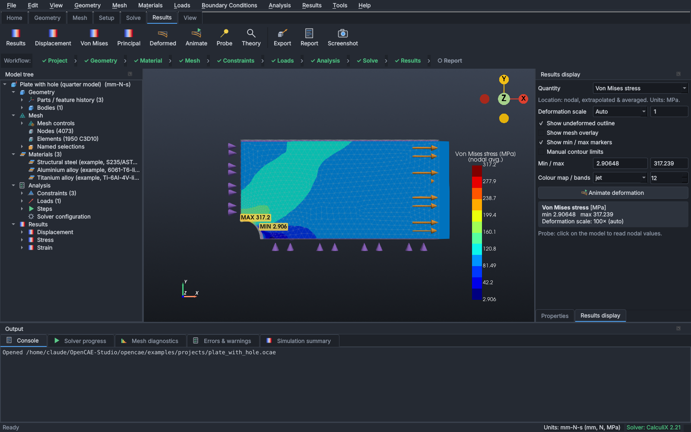

# OpenCAE Studio

An open-source desktop CAE application for drone engineering that takes parts and assemblies from **CAD geometry
→ mesh → structural, thermal, modal/buckling or flow analysis → results, plots and reports** in one workflow.
Each project holds several **studies** (for example a static load case, a modal check, a thermal study feeding a
thermal-stress study, and a CFD study of the same arm).



| Layer | Library (tested version) | Role |
|---|---|---|
| UI | PySide6 6.12 (Qt) | dark-themed main window, ribbon, docks |
| 3-D view | VTK 9.6 / PyVista 0.49 / pyvistaqt 0.13 | rendering, picking, contours |
| CAD kernel | OpenCascade via OCP 8.0 (`cadquery-ocp`) | B-rep primitives, booleans, fillets, STEP/IGES |
| Mesher | Gmsh 4.15 Python API | C3D4 / C3D10 tetrahedra, local refinement |
| Solver | CalculiX 2.21 (`ccx`, external process) | static (linear / NLGEOM), modal, buckling, steady & transient heat, thermal stress |
| CFD solver (optional) | SU2 8.x (`SU2_CFD`, external process) | steady incompressible flow, laminar / SA / SST, 2-D and 3-D |
| Data | NumPy, SciPy, meshio, Matplotlib | arrays, export, plots |

Everything shown by the application is computed by the real pipeline. No result is predetermined, and the
validation suite checks results against closed-form solutions (see [Validation](#validation)).

## Installation

Requirements: Python ≥ 3.11 and the CalculiX `ccx` executable; SU2 only for flow studies.

**Windows / Miniforge** (GUI env `qt_test`, CalculiX in env `opencae`): run `launch_opencae.bat`
(`--doctor`, `--acceptance`). See [docs/WINDOWS_SETUP.md](docs/WINDOWS_SETUP.md), which also explains the
CalculiX DLL problem (`-1073741515`) and how it is solved without changing any system setting.

```bash
# 1. CalculiX (solver) - system package
sudo apt install calculix-ccx            # Debian/Ubuntu   (Fedora: dnf install calculix-ccx,
                                         # macOS: brew install calculix-ccx, conda: -c conda-forge calculix)
# 2. OpenCAE Studio
python3 -m venv .venv && source .venv/bin/activate
pip install -e .            # or: pip install -r requirements.txt && pip install -e .
# Linux desktops may also need Qt's xcb libraries: sudo apt install libxcb-cursor0 libxkbcommon-x11-0
```

If `ccx` is not on `PATH`, set `OPENCAE_CCX=/path/to/ccx` or use **Tools → Settings**. Without CalculiX the
application still runs: modelling and meshing work, and solving is disabled with an explanation.

## Running

```bash
opencae-studio                                  # start the GUI
opencae-studio --example cantilever             # start with the cantilever demonstration
opencae-studio opencae/examples/projects/plate_with_hole.ocae
python -m opencae.examples.run_validation --out validation_output   # benchmarks A-E
python -m opencae.examples.build_examples       # rebuild + solve the example projects
pytest                                          # tests (GUI tests need a display: xvfb-run pytest)
```

### First demonstration: cantilever beam (≈ 1 minute)

1. **File → Open cantilever example** (or Geometry → Cantilever beam…). This creates a 200 × 20 × 20 mm steel
   beam, fixes the `x = 0` face and applies 1000 N in −Z on the tip face.
2. **Mesh → Generate mesh** (Ctrl+M). Meshing runs in a background process; see *Mesh diagnostics*.
3. **Analysis → Solve** (F5). CalculiX runs in the background and can be cancelled.
4. Results open automatically. Switch quantities in *Results display*, click the model to probe values, and use
   **Results → Compare with theory**: FE tip deflection ≈ 1.0001 mm vs Euler–Bernoulli 1.000 mm.
5. **File → Save project** and reopen it. Mesh and results are restored and marked current.
6. **File → Export report** writes an HTML or PDF report with figures, equilibrium check and theory comparison.

## Feature status

✅ implemented and covered by automated tests · 🟡 implemented with stated limitations · ⬜ not implemented

| Area | Status |
|---|---|
| Primitives, transform, booleans, fillet / chamfer, extrude, parametric history | ✅ |
| STEP / IGES / BREP import & export; multi-file import, drag & drop, **one body per solid** for assemblies | ✅ |
| STL: diagnostics (open / non-manifold / degenerate / mis-oriented edges, shells), split into shells, faceted-solid reconstruction with user-set sewing tolerance (no automatic gap filling) | ✅ |
| Assembly tools: bodies per study, isolate / show all, contact & interference check | ✅ |
| Ribbon (Home, Geometry, Assembly, Materials, Mesh, Physics & Setup, Boundary Conditions, Solve, Results, Reports, View, Tools), workflow bar with 6 states | ✅ |
| Studies: new / duplicate / rename / delete / activate, per-study bodies, materials, mesh, conditions, results; dashboard | ✅ |
| Mesh: C3D4 / C3D10 tets, C3D8(I) / C3D20(R) hexes for box-like volumes, target element count, size / min / curvature / growth / smoothing / algorithms, local refinement, quality metrics | ✅ / 🟡 all-hex only for box-like (transfinite) volumes; no 3-D boundary-layer prisms |
| Multi-body bonded meshes (conformal at shared faces), per-body materials | ✅ |
| Separately meshed bodies with interactions: bonded (tie, non-matching meshes) and surface-to-surface penalty contact with friction; touching-face detection | ✅ / 🟡 contact: small sliding, penalty method, static studies only |
| Mesh convergence study (background, Celik GCI, singularity detection) | ✅ |
| Static structural: supports, displacements, symmetry, force, **moment**, **remote force**, pressure, gravity; NLGEOM | ✅ / 🟡 no local coordinate systems |
| Modal (frequencies, mode shapes, effective mass), linear buckling | ✅ |
| Steady & transient heat conduction: temperature, flux, power, convection, radiation, heat generation | ✅ |
| Thermal stress from a thermal study (mesh-to-mesh interpolation) or a uniform temperature | ✅ |
| Flow (SU2): internal and external (flow-domain tool), 2-D planar and 3-D, laminar / SA / SST, inlets, outlets, walls, slip walls; flow rates, pressure drop, wall forces, coefficients | ✅ / 🟡 steady incompressible isothermal only; see [docs/CFD.md](docs/CFD.md) |
| Results: contours, frames (modes / time steps), probe, section plane, deformation & mode animation, velocity vectors, streamlines | ✅ |
| Plot Explorer: line plots with study overlay, histories, spectra, convergence charts; PNG / CSV | ✅ |
| Reports (HTML / PDF) per study: equations, assumptions, materials, mesh, conditions, results, checks, figures, engineering notes | ✅ |
| Solver diagnostics: isolated solver environment, DLL dependency check (incl. MKL forwarders), Test Solver / Test SU2, `solver.log` per run | ✅ |
| Packaged executable | 🟡 see [docs/PACKAGING.md](docs/PACKAGING.md) |
| Nonlinear materials, transient structural dynamics, local coordinate systems, 3-D boundary-layer prisms, fatigue, composites, optimisation, FSI | ⬜ |

## Validation

`python -m opencae.examples.run_validation` runs the structural benchmarks A–E and the extended benchmark set X
through the full pipeline. The full run takes about 16 minutes (most of it the 445 000-cell pipe flow; `--quick`
takes about 2 minutes, `--no-extended` about 35 s). The report is in
[docs/validation/validation_report.html](docs/validation/validation_report.html).

| Benchmark | Result |
|---|---|
| A. Axial bar, u = FL/(AE), σ = F/A | error < 1e-5 % on every mesh, C3D4 and C3D10 (linear exact solution) |
| B. Cantilever, δ = FL³/(3EI) | C3D10: 0.9982 → 1.0005 mm over 1k–40k nodes (EB 1.0000, Timoshenko 1.0077); C3D4 shows shear locking (−52 % → −4.8 %) |
| C. Convergence | C3D10 observed order 3.6, Richardson tip deflection 1.00063 mm, GCI 0.012 %; mid-span bending stress within 0.1 % of Mc/I |
| D. Under-constraint | all three under-constrained cases blocked before solving. With the check bypassed, CalculiX "succeeds" with displacements of ~10¹⁰ mm |
| E. Units / serialization | mm-N-s vs m-N-s identical to 1e-6; reopened project reproduces inputs, mesh and results exactly |

Extended benchmarks (benchmark X, 23 quantities) cover heat conduction (exact to 0.001 %; transient 0.33 % at
dt = 5 s), modal (f1 −0.26 %), buckling (+0.08 %), end moment, large deflection (elastica −0.09 %), restrained
thermal expansion, 2-D channel (0.10 % at 32 cells), square duct (0.9 %), circular pipe (2.9 %) and sphere drag
(1.0 % vs correlation). Details and assumptions: [docs/VALIDATION.md](docs/VALIDATION.md).

## Documentation

* [User guide](docs/USER_GUIDE.md) — workflow, controls, units, conventions
* [Architecture](docs/ARCHITECTURE.md) — modules, data flow, extension points
* [Validation](docs/VALIDATION.md) — benchmark results and limitations
* [Windows setup](docs/WINDOWS_SETUP.md) — launcher, solver environment, SU2
* [Flow (CFD)](docs/CFD.md) — SU2 adapter, workflow, limitations
* [Roadmap](docs/ROADMAP.md)
* [Packaging](docs/PACKAGING.md)

## Important limitations

* Isotropic linear-elastic materials, no plasticity. Touching bodies are bonded unless meshed separately and
  connected by interactions; contact is a basic penalty formulation (check penetration and mesh sensitivity).
* Flow: steady, incompressible, isothermal (see [docs/CFD.md](docs/CFD.md)).
* Built-in material values are representative examples and are flagged as such in the UI and reports. Verify
  them before any engineering use.
* Peak stresses at re-entrant corners and clamped edges are singular and grow with mesh refinement. Use the
  convergence tools and judge stresses away from singularities.

## License

OpenCAE Studio is licensed under **GPL-3.0-or-later** (see `LICENSE`). This follows from the in-process use of
Gmsh (GPL-2.0-or-later). Other dependencies are compatible: PySide6 (LGPL-3.0), VTK (BSD-3), PyVista and
pyvistaqt (MIT), OCP (Apache-2.0) over OpenCascade (LGPL-2.1 with exception), meshio (MIT), NumPy/SciPy (BSD),
Matplotlib (PSF-based). CalculiX (GPL-2.0) and SU2 (LGPL-2.1) run as separate programs and are not bundled.
